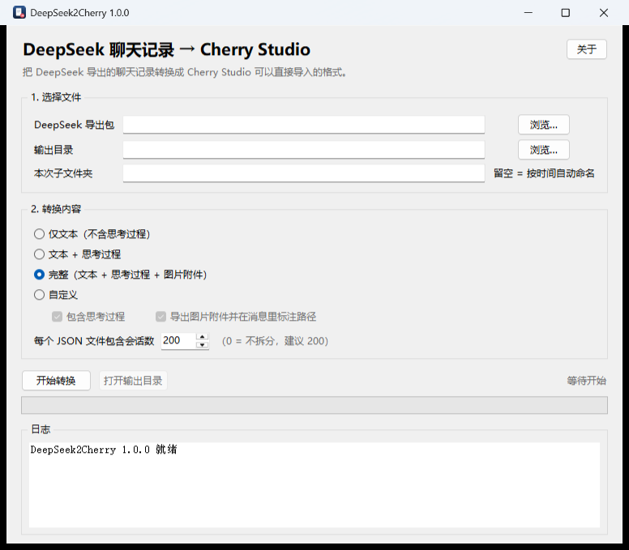

# DeepSeek 聊天记录迁移器 · DeepSeek Chat History Migrator

把 **DeepSeek 网页版 / App 的聊天记录**完整搬进 **Cherry Studio**。程序名：`DeepSeek2Cherry.exe`。




DeepSeek 官方导出的 zip 无法直接导入 Cherry Studio——Cherry 只认 ChatGPT 和 Claude 的导出格式。这个工具在本地做格式转换，并且尽量保留原始信息：消息树和分支、思考过程、图片原件。

> 纯本地运行：不联网、不上传、不需要安装 Python，双击 exe 即可使用。

## 为什么会有这个工具

DeepSeek C 端开始限额后，不少用户把会话迁到 API 客户端。Cherry Studio 是其中体验最接近的一个，但它的导入功能不支持 DeepSeek 的导出结构（`export_format_version: 3`）。手动整理几万条消息不现实，所以写了这个转换器。

## 功能

- **三种转换模式**：仅文本 / 文本 + 思考过程 / 完整（文本 + 思考 + 图片附件），也支持自定义组合
- **保留分支**：被重新生成掉的旧答案、被内容过滤后重发的提问都保留，导入后可切换查看
- **图片原件导出**：按会话分文件夹保存，并在原消息末尾标注 `[图片：attachments/…]`
- **附件索引**：`附件索引.csv` 记录每个附件所属会话、消息和导出状态
- **每次转换独立目录**：默认按时间命名子文件夹，也可自定义，重名自动加 `-2`，不会覆盖上次结果
- **分批输出**：默认每 200 个会话一个 JSON，避免单文件过大导致导入卡死
- **图形界面 + 命令行**：exe 双击即用，CLI 支持拖拽和脚本化

## 快速开始

### 1. 下载

到 [Releases](https://github.com/CaZaYa/deepseek-chat-history-migrator/releases) 下载 `DeepSeek2Cherry.exe`（图形界面）或 `DeepSeek2Cherry-CLI.exe`（命令行）。

### 2. 从 DeepSeek 导出

网页版左下角头像 → **系统设置** → **数据管理** → **导出所有历史对话** → 等待生成后下载，得到 `deepseek_data-日期.zip`。

### 3. 转换

双击 `DeepSeek2Cherry.exe`：

1. 选择导出的 zip
2. 选择输出目录（程序会自动在里面新建子文件夹，可自定义名字）
3. 选择转换模式
4. 点「开始转换」

### 4. 导入 Cherry Studio

**设置 → 数据 → 导入外部应用数据 → 导入 ChatGPT 数据**，选择输出目录里的 `conversations-*.json`，逐个导入。

> 同一个文件不要导入两次，否则会话会重复。如果导错了，先删掉已导入的会话再重新导入。

## 转换模式

| 模式 | 文本 | 思考过程 | 图片附件 |
| --- | --- | --- | --- |
| `text` 仅文本 | ✅ | ❌ | ❌ |
| `thinking` 文本 + 思考 | ✅ | ✅ | ❌ |
| `full` 完整（默认） | ✅ | ✅ | ✅ |

思考过程以引用块形式放在助手消息前面，导入后仍然可读。

## 输出结构

```
你选的输出目录/
└─ 20261116-1840/          # 每次转换自动新建的子文件夹
   ├─ conversations-1.json # 最近 200 个会话
   ├─ conversations-2.json
   ├─ … 
   ├─ attachments/
   │  └─ 0004-会话标题/    # 该会话的图片原件
   └─ 附件索引.csv
```

## 命令行（可选）

最省事的方式：**把导出的 zip 直接拖到 `DeepSeek2Cherry-CLI.exe` 图标上**，按提示选择模式。

也可以在终端里执行（在该文件夹地址栏输入 `cmd` 回车，即可在当前目录打开终端）：

```bash
DeepSeek2Cherry-CLI.exe <导出包.zip> <输出目录> --mode full
DeepSeek2Cherry-CLI.exe <导出包.zip> <输出目录> --mode full --name 我的备份
```

`--mode` 可选 `text` / `thinking` / `full`，默认 `full`；`--name` 指定本次子文件夹名，省略则按时间命名。

## 常见问题

**Q：为什么有些附件提示「导出包未包含原件」？**  
DeepSeek 的导出包只打包图片原件，PDF、Word、代码等附件只有文件名；少数早期图片在服务器端也已不存在。不是工具漏抓。

**Q：导入后助手消息为什么显示 GPT-5？**  
Cherry Studio 的 ChatGPT 导入器固定写入的显示标识，不影响内容和后续对话。

**Q：为什么有的会话显示成多个分支？**  
重新生成过的回答会作为兄弟分支保留；被内容过滤后重发的提问在 DeepSeek 原始数据里本来就是独立根节点。转换按原样保留。

**Q：导入后会话重复了怎么办？**  
说明同一个 JSON 导入了两次。删掉重复会话即可。

**Q：单个 JSON 多大合适？**  
建议 50MB 以内。默认每 200 个会话一批通常在这个范围；超长历史可把每批调小到 100。

**Q：支持 macOS 吗？**  
目前只提供 Windows 64 位打包版；源码跨平台，可用 Python 运行。

## 隐私与安全

- 不联网、不上传任何数据，不写注册表，不需要管理员权限
- 只读取你选择的 zip，并把结果写入你选择的输出目录
- exe 由 GitHub Actions 从本仓库源码构建，可自行核对或从源码重新打包

## 已知限制

- 只支持 DeepSeek 的 `export_format_version: 3` 导出包
- 导出包内只有图片原件，其他附件无法恢复
- 联网搜索的中间结果（搜索列表、打开的网页）不导入，只保留正文文字
- 导入后的会话统一显示 GPT-5 图标，这是 Cherry Studio 的行为
- exe 未做代码签名，首次运行可能被 SmartScreen 提示，点「更多信息 → 仍要运行」

## 从源码运行与构建

需要 Python 3.9+。

```bash
python -m dsc2cherry                    # 图形界面
python -m dsc2cherry <zip> <out> --mode full   # 命令行
python -m unittest discover -s tests    # 运行测试
build.bat                                # 打包 exe 到 dist/
```

## 使用手册

- [中文 PDF](使用手册.pdf) · [中文 Word](docs/使用手册.docx)
- [English PDF](User%20Manual%20%28EN%29.pdf) · [English Word](docs/User%20Manual%20%28EN%29.docx)

## 示例数据

`samples/示例DeepSeek导出.zip` 是一份完全虚构的导出包，覆盖思考过程、分支、内容过滤、图片附件和缺失附件，可用来试转换。

## 许可与声明

MIT License，详见 [LICENSE](LICENSE)。

本项目与 DeepSeek、Cherry Studio 官方无关联，仅为社区工具。请仅处理你自己导出的数据，并在导入前备份 Cherry Studio 数据。
